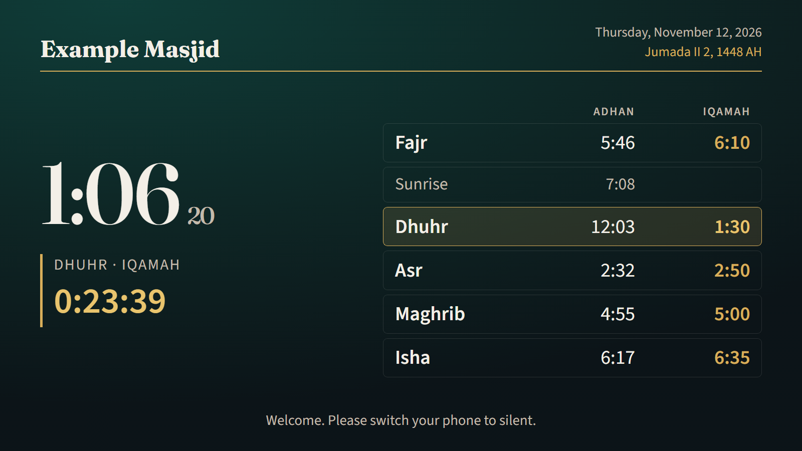

# Masjid Board

A free, open-source prayer-times screen for masjids. Put it on any TV with a browser: a smart TV, a Fire TV Stick, a Raspberry Pi or an old laptop.

- Adhan times calculated for your location (every major method, Hanafi or Shafi Asr)
- Iqamah times as fixed clock times or "minutes after adhan", rounded to the nearest 5 minutes if you like
- Jumu'ah with one or more khutbah times on Fridays
- Live clock, countdown to the next adhan or iqamah, Gregorian and Hijri dates
- Flips to tomorrow's times after Isha, so the screen is never showing the wrong day
- Rotating announcements
- English, Arabic and Urdu, with right-to-left layout (more languages welcome)
- Landscape and portrait screens
- No build step, no server, no account, no tracking. Plain HTML, CSS and JavaScript.

## Set it up in 10 minutes

1. **Fork** this repository (button at the top right of GitHub).
2. In your fork, open `config.json`, click the pencil icon and change:
   - `masjid.name`
   - `location.latitude` and `location.longitude` (right-click your masjid in Google Maps to copy them)
   - `calculation.method` and `calculation.madhab`
   - your `iqamah` times, `jumuah` times and `announcements`
3. Go to **Settings > Pages**, choose **Deploy from a branch**, pick `main` and `/ (root)`, and save.
4. After a minute your board is live at `https://<your-username>.github.io/masjid-board/`. Open that address on the TV and make the browser full screen.

The screen uses the TV's own clock and time zone, so make sure the device's date, time and time zone are set correctly.

To try it on your computer first: `npx serve .` (or `python -m http.server`) in this folder, then open the address it prints. Opening `index.html` straight from disk will not work, because browsers block loading `config.json` from a file.

## Settings

| Setting | What it does | Example |
|---|---|---|
| `masjid.name` | Name across the top | `"Masjid Al-Noor"` |
| `location.latitude`, `location.longitude` | Where to calculate adhan times for | `43.6532`, `-79.3832` |
| `calculation.method` | `NorthAmerica` (ISNA), `MuslimWorldLeague`, `Egyptian`, `Karachi`, `UmmAlQura`, `Dubai`, `Qatar`, `Kuwait`, `MoonsightingCommittee`, `Singapore`, `Turkey`, `Tehran` | `"NorthAmerica"` |
| `calculation.madhab` | `Shafi` (standard Asr) or `Hanafi` (later Asr) | `"Hanafi"` |
| `calculation.highLatitudeRule` | For far-north places in summer: `MiddleOfTheNight`, `SeventhOfTheNight` or `TwilightAngle` | `"MiddleOfTheNight"` |
| `calculation.adjustments` | Minutes to add to (or take from) each adhan | `{ "isha": 2 }` |
| `iqamah` | Per prayer: `"+15"` means 15 minutes after adhan, `"13:30"` means a fixed time (never earlier than adhan) | `{ "fajr": "+20", "dhuhr": "13:30" }` |
| `iqamahRoundMinutes` | Rounds "+N" iqamah times up to this many minutes | `5` |
| `jumuah` | Khutbah or Jumu'ah prayer times, shown on Fridays in place of Dhuhr | `["13:15", "13:45"]` |
| `rolloverAfterIshaMinutes` | How long after the last Isha iqamah the screen switches to tomorrow | `60` |
| `hijriOffsetDays` | Move the Hijri date by a day or two to match local moon sighting | `-1` |
| `language` | A file name in `i18n/` | `"en"`, `"ar"`, `"ur"` |
| `theme` | A file name in `themes/` | `"teal"` |
| `clock` | `"12h"` or `"24h"` | `"12h"` |
| `announcements` | Lines that rotate along the bottom every 12 seconds | `["Halaqa after Isha on Thursday"]` |

You can also preview a language or theme without editing anything: add `?lang=ar` or `?theme=teal` to the address.

## Contributing

This project is built to be easy to help with. You do not need to be a programmer to add a language, and a theme is a single CSS file. See [CONTRIBUTING.md](CONTRIBUTING.md) and the [roadmap](docs/ROADMAP.md).

## Credits

Adhan times are calculated with [adhan-js](https://github.com/batoulapps/adhan-js) by Batoul Apps (MIT licence), included in `vendor/`.

## Licence

MIT. Free for any masjid, school or organisation to use, change and share.
